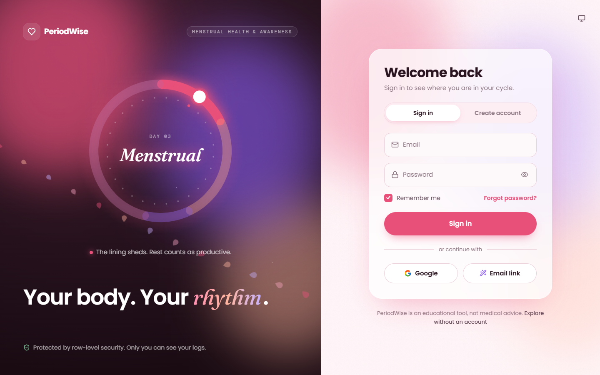
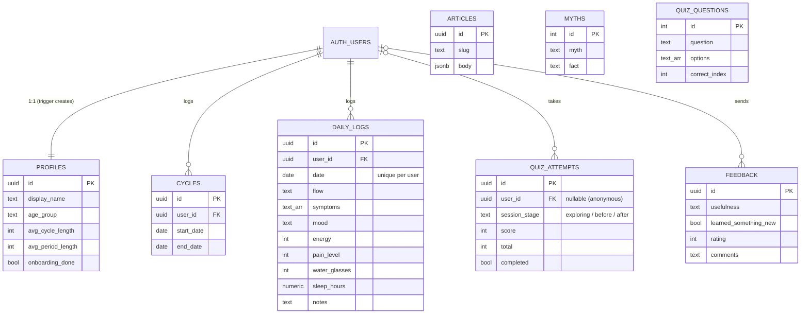

# PeriodWise

**A private period tracker and menstrual health awareness platform.**
2nd-year mini project · React + Supabase



PeriodWise does two jobs in one app:

1. **Tracker.** Log periods and daily symptoms, see where you are in your cycle, and get estimates for your next period, fertile window and ovulation.
2. **Awareness.** Articles, myth-busting flip cards and a 10-question quiz. Quiz scores taken before and after an awareness session are compared live on the home page, so a campaign can measure what people learned.

---

## Features

| Area | What it does |
| --- | --- |
| **Auth** | Email and password, Google OAuth, magic link, forgot/reset password, "Remember me" (persistent vs. tab-only session), protected routes |
| **Onboarding** | 3-step animated setup (name → last period → cycle and period length) with a live preview ring |
| **Dashboard** | Phase ring with cycle day and colour-coded phase, countdown to next period, fertile window, ovulation estimate, quick "period started / ended" actions, tips for the current phase, doctor nudges |
| **Calendar** | Month grid showing logged periods, predicted periods, fertile window and ovulation. Tap any day to open a log sheet (flow, symptoms, mood, energy, pain, water, sleep, notes) |
| **Insights** | Cycle-length history (with the 21–35-day normal band), period length, top symptoms, mood trend, regularity score |
| **Learn** | Sections A–F with a sticky, scroll-synced topic bar |
| **Myths & Facts** | 3D flip cards with search and category filters |
| **Quiz** | Animated progress, instant explanation after each answer, confetti on a good score, answer review, score history when signed in |
| **Feedback** | Anonymous form saved to Supabase |
| **Share via QR** | Generates a QR poster for awareness sessions (download PNG, print) |
| **Profile** | Edit cycle defaults, theme, export data as CSV, delete account and all data |
| **Everywhere** | Dark mode, responsive from 360 px, keyboard and screen-reader friendly, respects `prefers-reduced-motion`, skeleton loaders, toasts, empty and error states |

---

## Tech stack

- **Frontend:** React 19, TypeScript, Vite, Tailwind CSS v4, Motion (Framer Motion), React Router, TanStack Query, Recharts, lucide-react
- **Backend:** Supabase (Postgres, Auth, Row Level Security, SQL functions)
- **Hosting:** any static host. Vercel config is included (`vercel.json` SPA rewrites).

There is no custom server. The browser talks to Supabase directly with the **publishable** key. Security comes from Row Level Security policies in the database, not from hiding the key.

---

## Setup

### 1. Install

```bash
npm install
cp .env.example .env.local   # then fill in your project URL + publishable key
npm run dev                  # http://localhost:5173
```

`.env.local`:

```
VITE_SUPABASE_URL=https://<project-ref>.supabase.co
VITE_SUPABASE_PUBLISHABLE_KEY=sb_publishable_...
```

> Never put the `sb_secret_...` key in `.env.local` or anywhere under `src/`. It bypasses all security rules.

### 2. Database setup

Open **Supabase Dashboard → SQL Editor → New query**, paste the whole of [`supabase/setup.sql`](supabase/setup.sql) and click **Run**. It is safe to re-run.

The same SQL is split into migrations in `supabase/migrations/` if you prefer the Supabase CLI (`npx supabase link` then `npx supabase db push`).

The seed (articles, myths, quiz) is generated from `src/content/*.ts` by `npm run gen:seed`. The app also bundles this content as a fallback, so the public pages work even before the database is ready.

### 3. Going live: let anyone sign up (Supabase Dashboard)

1. **Custom SMTP (required).** Supabase's built-in email only delivers to your own project team's addresses and is limited to a few emails per hour, so strangers would never get their confirmation email. Under **Authentication → Emails → SMTP Settings**, plug in a provider such as [Resend](https://resend.com), Brevo, Postmark or AWS SES, using a sender on a domain you own (e.g. `no-reply@yourdomain.com`).
2. **URL Configuration** (Authentication → URL Configuration): set **Site URL** to your production URL (e.g. `https://periodwise.vercel.app`). Add `https://<your-domain>/**` and `http://localhost:5173/**` to **Redirect URLs**. If this still says `localhost`, confirmation links will be broken.
3. **Confirm email:** keep it **on** (Sign In / Providers → Email) so people must own the address they sign up with.
4. **Rate limits** (Authentication → Rate Limits): once custom SMTP is set, raise "emails sent per hour" to match expected signups (e.g. 100+).
5. **Bot protection (recommended):** turn on CAPTCHA under Authentication → Attack Protection (Cloudflare Turnstile is free). This needs a small frontend change to pass the token; open an issue or ask for it.
6. **Passwords:** under Sign In / Providers → Email, set minimum length to 8 and require letters + digits.
7. **Run the latest SQL:** re-run [`supabase/setup.sql`](supabase/setup.sql) after pulling (it is idempotent) so the hardening migration is applied.
8. **Google sign-in (optional):**
   1. In Google Cloud Console → APIs & Services → Credentials, create an **OAuth client ID** (type: Web application).
   2. Under **Authorized redirect URIs**, add `https://<project-ref>.supabase.co/auth/v1/callback`.
   3. In Supabase → Authentication → Sign In / Providers → **Google**, turn it on and paste the Client ID and Client Secret.
   4. Set `VITE_ENABLE_GOOGLE=true` in Vercel and redeploy. The Google button is hidden until then.

**Vercel environment variables** (Project → Settings → Environment Variables, scope *Production*): `VITE_SUPABASE_URL`, `VITE_SUPABASE_PUBLISHABLE_KEY`, and optionally `VITE_ENABLE_GOOGLE`. They are baked in at build time, so **redeploy after changing them**.

**Security headers** (CSP, HSTS, no framing, nosniff, referrer and permissions policy) are set in `vercel.json`.

### 4. Demo account (optional)

Fills an account with about 6 months of realistic history, so the dashboard, calendar and insights have something to show:

```bash
# PowerShell
$env:SUPABASE_SECRET_KEY="sb_secret_..."; npm run seed:demo
# bash
SUPABASE_SECRET_KEY=sb_secret_... npm run seed:demo
```

Then sign in with **demo@periodwise.app / PeriodWise-demo-2026**. The secret key is read from the environment only for this local script.

> On a public deployment, anyone who reads this README can log into the demo account and change its password. Seed it only on a dev project, or delete it under Authentication → Users before going live.

### 5. Deploy (Vercel)

```bash
npm i -g vercel
vercel                 # set VITE_SUPABASE_URL and VITE_SUPABASE_PUBLISHABLE_KEY when prompted / in project settings
vercel --prod
```

Remember to add the production URL to Supabase **Redirect URLs**.

---

## Database schema



### Security model (Row Level Security)

| Table | anon | signed-in user |
| --- | --- | --- |
| `profiles`, `cycles`, `daily_logs` | none | read and write **own rows only** (`auth.uid() = user_id`) |
| `articles`, `myths`, `quiz_questions` | read | read |
| `quiz_attempts` | write via RPC only | read own history; write via RPC |
| `feedback` | insert only | insert only (nobody can read others' feedback) |

SQL functions (`security definer`):

- `get_campaign_stats()` returns **aggregates only** (counts and averages), never rows. It powers the live Community Impact section.
- `start_quiz_attempt()` / `finish_quiz_attempt()` record quiz attempts without giving anyone select access to the table.
- `delete_my_account()` deletes the caller's auth user. Their data goes with it through `on delete cascade`.
- `handle_new_user()` trigger creates a profile for every signup (email or Google).

---

## How predictions work (`src/lib/cycle.ts`)

1. **Cycle length** is the gap between consecutive period start dates. Gaps outside 10–90 days are ignored.
2. **Average cycle** is the mean of the last 3–6 real cycle lengths. With fewer than 2, it falls back to the profile setting (default 28).
3. **Next period** = last start + average cycle.
4. **Ovulation** is about 14 days before the next period (the luteal phase is fairly constant). **Fertile window** = 5 days before ovulation to 1 day after.
5. **Phases:** menstrual (day 1 → period length), follicular, ovulation (ovulation day ± 1), luteal.
6. **Regularity score** = `100 − 12 × standard deviation` of cycle lengths, clamped to 0–100.
7. **Doctor nudges** appear for repeated cycles shorter than 21 or longer than 35 days, a period longer than 7 days, repeated severe pain (8+/10), or high variability. They are always worded as suggestions, never diagnoses.

Every prediction is labelled *estimate only* and *not a method of contraception*.

---

## Project structure

```
src/
  components/   CycleRing (signature), Brand (logo, aurora, theme toggle), Layouts, LogSheet, MythCard, ui primitives
  content/      articles, myths, quiz — bundled fallback + source for the SQL seed
  context/      AuthProvider, ThemeProvider
  lib/          supabase client, queries (TanStack Query hooks), cycle engine, types, utils
  pages/        Home, Auth, Learn, Myths, Quiz, Feedback, Share, ResetPassword, NotFound
  pages/app/    Onboarding, Dashboard, Calendar, Insights, Profile
supabase/
  migrations/   schema + generated seed
  setup.sql     one-paste version of both
scripts/        gen-seed.ts, seed-demo.ts
```

---

## Demo and viva talking points

1. **The login screen is the thesis.** The orbit ring is a real 28-day cycle drawn as four phase arcs. The glowing "moon" travels through them, and each phase shows its own fact. A successful sign-in completes the ring, turns it into the heart logo, and opens into the dashboard. The same ring component shows *your* cycle on the dashboard.
2. **Security without a backend server.** The browser holds only the publishable key. Row Level Security means a user can't read anyone else's logs even with hand-crafted API calls. The secret key never ships to the browser.
3. **Privacy by design.** Export your data as CSV and delete your account in one click (a cascade removes everything). Feedback and quiz attempts can be anonymous.
4. **Predictions adapt to the user.** They use the person's own last 3–6 cycles, not a fixed 28 days, and fall back gracefully when there isn't enough data yet.
5. **Measurable impact.** Quiz attempts are tagged *before* or *after* an awareness session, and an aggregate-only SQL function shows the improvement live on the home page.
6. **Responsible health content.** Medically reviewed basics (NHS / WHO / ACOG sources on myth cards), inclusive language, clear "not medical advice" disclaimers, and gentle doctor nudges instead of diagnoses.
7. **Resilience.** Educational content is bundled as a fallback, so the awareness pages work offline-ish or before the database is seeded.
8. **Quality floor.** Dark mode, mobile-first layouts, keyboard navigation, screen-reader labels, and reduced-motion support (the ring steps between phases instead of orbiting).
9. **Data model choices.** One row per period (`cycles`) and one row per day (`daily_logs`, unique per user and date, upserted). This keeps predictions simple and logging idempotent.

---

*PeriodWise provides general educational information and is not a substitute for professional medical advice.*
